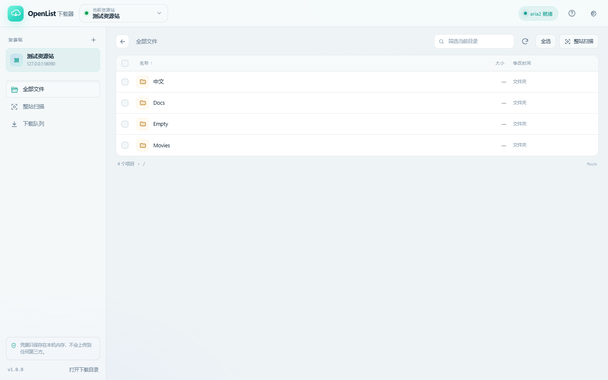
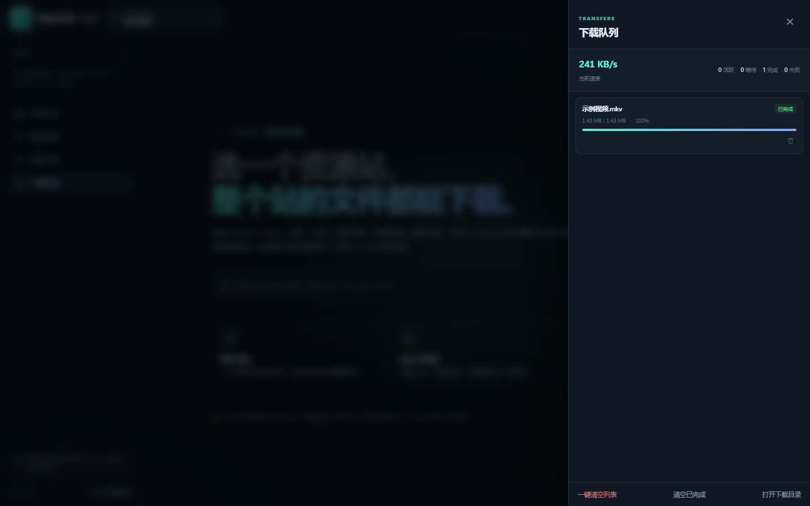
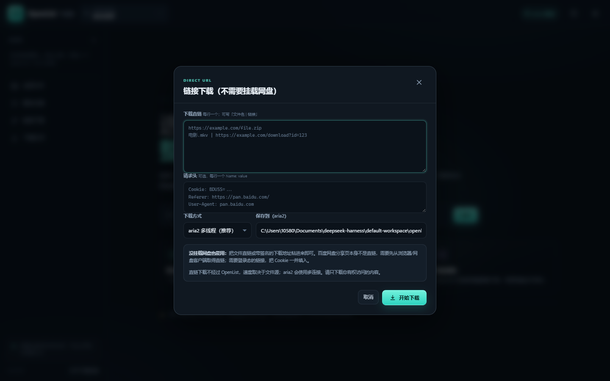
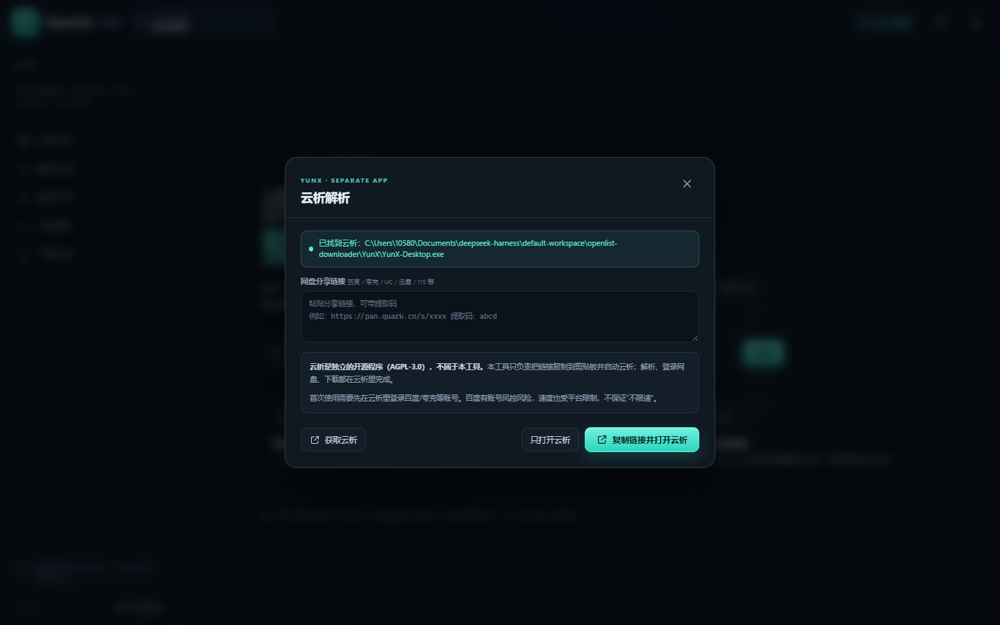

# OpenList 下载器

一个 **桌面窗口** **OpenList 地址、百度/夸克等分享链接、普通文件直链**，自动识别并下载。也支持浏览资源站、跨目录勾选、整站扫描，并用内置下载引擎或 **aria2** 下载。

> 百度网盘、阿里云盘、夸克、OneDrive、Google Drive 等网盘，输入链接自动解析然后下载，下载openlist文件不需要再手动搭建aria2







## 能做什么
- **不限速**：下载文件基本能跑满宽带
- **独立桌面窗口**：不是浏览器标签页，没有地址栏；程序只在本机开服务
- **浏览器下载**：不需要 aria2。单个文件直接下载，多文件/文件夹自动打包为 ZIP，并保留目录结构
- **整站扫描**：遍历资源站全部目录，统计文件数和总大小，然后一键下载全部
- **百度网盘和其他网盘**：通过 OpenList 的挂载访问。先在 OpenList 后台挂好账号，这里即可直接取回文件
- **断点续传/多线程**：aria2 任务支持进度、速度、暂停、继续、移除；网盘需要的鉴权头由程序自动带上
- **不挂载网盘也能下**：侧栏“链接下载”可以直接粘贴 http/https 直链或带 Cookie 的下载地址。百度分享页本身不是直链，需要先取得直链（说明见下文）
- **内置yunxdektop**：发布包内附 YunX-Desktop 便携版；侧栏“云析解析”把百度/夸克/UC/迅雷/115 等分享链接复制到剪贴板并启动云析，由云析登录网盘并解析下载
- **极速模式**：aria2 默认 16 连接/任务、8 任务并发，优先直连文件源，减少本机中转；设置里有“一键提速”和兼容代理开关

## 快速开始

### 方式一：直接运行（推荐）

1. 解压**完整发布包**到一个有写入权限的文件夹（不要只拖出 exe；云析解析依赖旁边的 `YunX/`，也不要放在 `C:\Program Files` 等只读位置）。
2. 双击 `OpenList下载器.exe`。如果 Windows 首次运行提示“未知发布者”，选择“更多信息 → 仍要运行”。
3. 程序会打开一个**独立的桌面窗口**（不是浏览器标签页，默认 `http://127.0.0.1:8765/`）。
4. 在欢迎页的输入框粘贴地址：OpenList 站点（如 `http://192.168.1.8:5244`）、百度/夸克分享链接、或文件直链。
5. 如果站点是私有的，输入 OpenList 用户名/密码，或直接粘贴访问令牌。
6. 进入文件列表后：
   - 点文件夹进入下一级；
   - 勾选文件或整个文件夹；
   - 点“下载所选”，选择“浏览器下载”或“aria2 多线程”；
   - 或者点“整站扫描”，扫描完成后“下载全部”。
7. 如果你没有挂载网盘，点侧栏“链接下载”，粘贴文件直链（可写 `文件名 | 链接`），选择 aria2 即可。
8. 想解析百度/夸克等**分享页**，点侧栏“云析解析”，粘贴分享链接，点“复制链接并打开云析”。首次使用需在云析中登录对应网盘。
## 界面说明

| 区域 | 用途 |
| --- | --- |
| 顶栏 | 当前资源站、aria2 状态、帮助、设置 |
| 左侧栏 | 资源站列表、全部文件、整站扫描、下载队列 |
| 文件区 | 面包屑导航、筛选、全选、下载所选 |
| 下载弹窗 | 选择浏览器或 aria2、保存目录、连接数 |
| 下载队列 | 实时进度、速度、剩余时间、暂停/继续/移除、一键清空 |
**如果你完全没有挂载网盘**：用“链接下载”粘贴直链即可，不需要 OpenList。但百度网盘分享页（`pan.baidu.com/s/...`）不是直链，本工具不会解析分享页；需要先在浏览器/网盘客户端取得直链，或配置 OpenList 挂载。需要登录态的直链，把 `Cookie`、`Referer`、`User-Agent` 填进“请求头”。
## 云析解析（独立组件）

发布包内附 **YunX-Desktop 1.3.4 便携版**（`YunX/` 文件夹）。它不是本工具的一部分，而是一个独立的开源程序：

- 在侧栏点“云析解析”，粘贴分享链接；
- 点“复制链接并打开云析”，本工具把链接写入剪贴板并启动 YunX；
- 首次使用在 YunX 里登录百度/夸克/UC/迅雷/115 等账号；
- 解析、预览、下载都在 YunX 内完成，本工具不读取 YunX 的账号或下载数据。

边界：

- YunX 使用 **AGPL-3.0**，源码见 <https://github.com/tidain/YunX-Desktop>，许可证见 `YUNX-LICENSE.txt`。
- 它不是“官方不限速接口”，本质是登录态 + 分片并发；百度网盘有账号风控风险，平台改接口也可能失效。
- 云析的下载队列和本工具的 aria2 队列是两套，任务不会自动合并。
- 如果不需要分享页解析，可以删除 `YunX/` 文件夹，本工具其余功能不受影响。



## aria2 说明

- 发布包内自带 `aria2c.exe`（GPL-2.0-or-later），程序会把它复制到数据目录并启动：
  - RPC 只监听 `127.0.0.1`；
  - 自动生成随机 RPC 密钥；
  - 默认端口 `16800`，被占用时自动换端口；
  - 默认 16 连接/任务、8 任务并发、64MB 磁盘缓存、HTTP keep-alive；
  - 默认下载目录：`%USERPROFILE%\Downloads\OpenList`。
- 设置里的“下载通道”可选：
  - **极速直连**：aria2 直接连接文件源，少一层本机中转；
  - **兼容代理**：经本机转发，兼容需要特殊请求头/防盗链的源。
- 想尽量跑满带宽：设置 → 一键提速，或手动把每任务连接数调到 16–32、同时下载调到 8–16。实际速度最终受源站带宽、网盘限速、路由器和磁盘限制，软件无法保证每个源都跑满。
- 如果系统里已经有 aria2 在运行，程序会优先复用（支持常见 6800 / 16800 端口，以及 `aria2.conf` 中的 `rpc-secret`）。
- 关闭网页不会中断 aria2；任务由后台 aria2 继续。重新打开程序后，队列会恢复。
- 任务通过本机 `/api/aria2/stream/<ticket>` 代理下载，所以网盘需要的 `Authorization`、`User-Agent`、`Referer`、`Cookie` 等请求头不会丢。

## 数据与隐私

数据目录默认在程序旁边的 `data/`：

```
data/
  config.json       资源站地址、下载目录、aria2 配置
  app.log           运行日志
  aria2.log         aria2 日志
  aria2.session     aria2 会话（断点续传）
  aria2_tasks.json  队列中任务的索引
  tickets.json      待下载链接的临时凭据（用于重启后续传）
  bin/aria2c.exe    从发布包复制出的 aria2
```

说明：
- 访问令牌只保存在内存会话中；如果 aria2 任务跨重启续传，对应的下载票据会临时保存到 `tickets.json`，默认 6 小时后过期。
- 所有请求都由本机后端代理，不会发往第三方服务器。
- 如果不需要保留任何记录，退出程序后删除 `data/` 即可。
- 不要把这个工具暴露到公网；它只绑定 `127.0.0.1`。

## 常见问题

**打不开页面 / 端口被占用**

程序会自动从 `8765` 往后找空闲端口，并打开独立窗口。如果窗口没有出来，查看 `data/app.log` 中的 `listening on ...`，手动访问该地址；也可以运行 `python app.py --no-browser` 用浏览器打开。

**连接资源站失败**

- 确认地址能从本机浏览器打开；
- OpenList 是否启用了 HTTPS 自签名证书？程序会自动兼容，但会在站点信息中标记；
- 如果 OpenList 配了反向代理子路径（如 `https://example.com/openlist`），请填写完整子路径；
- 私有站点请点“登录资源站”。

**浏览器下载很慢 / 打包很久**

ZIP 是边下边打包（不落临时文件），速度受源站带宽和本机磁盘影响。大文件建议用 aria2。

**aria2 显示未连接**

打开“设置 → aria2 → 启动内置 aria2”。如果仍然失败，查看 `data/aria2.log`。也可以切回“浏览器下载”，无需 aria2 也能用。

**aria2 提示“无法写入保存目录”**

通常是目录权限不足、被安全软件拦截，或目录正被其他程序占用。打开“设置”换一个可写目录（例如 `D:\Downloads\OpenList`），再重新添加任务。

**百度网盘下载 403 / 链接过期**

通常是 OpenList 的百度驱动登录态失效，或直链过期。回 OpenList 刷新目录/重新授权后再试。aria2 任务失败提示“下载链接已过期”时，重新添加任务即可。
## 技术栈

- 后端：Python 标准库（`http.server`、`urllib`、`zipfile`）
- 前端：原生 HTML / CSS / JavaScript，
- 下载：aria2 JSON-RPC + 本机流式代理
- 测试：`python -m unittest discover -s tests -v`，包含 Mock OpenList / Mock aria2 的端到端测试。
## 第三方组件

- **aria2 1.37.0**：GPL-2.0-or-later，二进制与许可证见 `tools/aria2/`。源码：<https://github.com/aria2/aria2>
- 本项目自身代码：MIT License，见 `LICENSE`。
